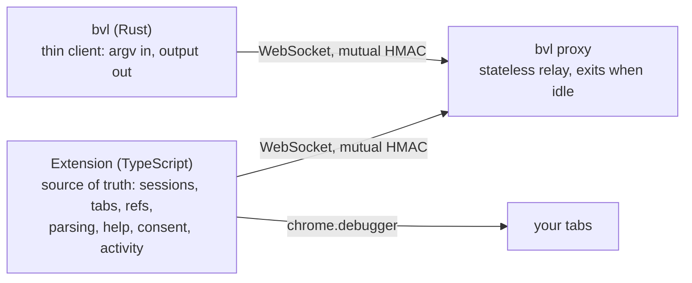

# Browser Valet

[](https://github.com/ThilinaTLM/browser-valet/actions/workflows/ci.yml)
[](https://github.com/ThilinaTLM/browser-valet/actions/workflows/release.yml)
[](https://github.com/ThilinaTLM/browser-valet/releases/latest)
[](LICENSE)

Let coding agents use your **real** Chrome — your logins, cookies and open tabs — through a small
CLI, `bvl`, whose commands mirror [agent-browser](https://github.com/vercel-labs/agent-browser).
You stay in control: agents only touch tabs they opened or tabs you explicitly approve.



- **Simple by design.** The CLI sends raw arguments; the extension parses, runs and formats
  everything (so new commands are extension-only). The proxy keeps no state and exits after 10
  idle minutes; the next `bvl` command starts it again.
- **Cross-platform.** One Rust binary for Linux, macOS and Windows; works with Chrome, Edge,
  Brave and other Chromium browsers (≥127).
- **Consent first.** Agent-opened tabs are the agent's. Any other tab needs your approval in a
  popup; you can revoke control at any time (popup, or close Chrome's "debugging" bar).
  `open <url>` never navigates away from a tab you shared; it opens an agent tab instead.
  Turning the extension off (popup switch) ends all control and clears every grant.
- **One binary.** `bvl` contains the extension and the agent skills, always version-matched.

## Install

You only need the `bvl` binary. Prebuilt binaries for every
[GitHub release](https://github.com/ThilinaTLM/browser-valet/releases) include the extension and the skills:

| Platform | Asset |
|---|---|
| Linux x86_64 / ARM64 (static) | `bvl-x86_64-unknown-linux-musl.tar.gz` / `bvl-aarch64-unknown-linux-musl.tar.gz` |
| macOS Intel / Apple Silicon | `bvl-x86_64-apple-darwin.tar.gz` / `bvl-aarch64-apple-darwin.tar.gz` |
| Windows x86_64 | `bvl-x86_64-pc-windows-msvc.zip` |

**Linux / macOS** (pick the target from the table; `~/.local/bin` must be on your `PATH`):

```sh
target=aarch64-apple-darwin
mkdir -p ~/.local/bin
curl -fsSL https://github.com/ThilinaTLM/browser-valet/releases/latest/download/bvl-$target.tar.gz \
  | tar -xz -C ~/.local/bin bvl
bvl version
```

**Windows** (PowerShell):

```powershell
$dir = "$env:LOCALAPPDATA\Programs\bvl"
Invoke-WebRequest https://github.com/ThilinaTLM/browser-valet/releases/latest/download/bvl-x86_64-pc-windows-msvc.zip -OutFile "$env:TEMP\bvl.zip"
Expand-Archive "$env:TEMP\bvl.zip" -DestinationPath $dir -Force
[Environment]::SetEnvironmentVariable("Path", "$([Environment]::GetEnvironmentVariable('Path','User'));$dir", "User")
# open a new terminal, then:
bvl version
```

Each release has a `SHA256SUMS` file for verifying downloads. For a specific version, replace
`latest/download` with `download/vX.Y.Z`. The binaries are not code-signed: if macOS blocks a copy
downloaded with a browser, run `xattr -d com.apple.quarantine bvl`. To build from source instead,
build the extension and run `cargo install --path cli` (see [Development](#development)).

Then:

```sh
bvl setup
```

`setup` writes the bundled extension to `<config dir>/extension`, opens `chrome://extensions`, and
copies the folder path to the clipboard. In the browser, do this once: turn on **Developer mode**,
click **Load unpacked**, and pick that folder. `setup` waits until the extension connects:

```
✓ Connected: Google Chrome 142 (extension v0.1.0)
```

There is no pairing step. `setup` puts a `pairing.json` with the shared secret in the extension
folder, and the extension reads it from there.

**Updates.** After you update `bvl`, the next connection notices that the extension is a
different version. The proxy rewrites the folder, and the extension reloads itself after any
running commands finish (it waits at most 2 minutes). Tab approvals carry over.

**Agents.** `bvl skills install` puts a small skill stub in `~/.agents/skills/bvl` and, if
`~/.claude` exists, in `~/.claude/skills/bvl` (or in `--dir D`). The stub tells the agent to run `bvl skills get core`, which prints the
full guide for the installed version.

> Chrome only installs extensions from the Chrome Web Store with one click (it rejects a `.crx`
> from anywhere else, even localhost). That's why setup uses Load unpacked. Chrome may sometimes
> warn about developer-mode extensions; the extension keeps working.

<details><summary>Manual pairing (extension loaded from <code>extension/dist</code> during development)</summary>

Click the Browser Valet toolbar icon, copy the pairing command it shows and run it:

```sh
bvl pair <code>
bvl status
```

A development build is not updated automatically; `bvl status` tells you when its version differs.
</details>

## Usage

```sh
bvl open https://example.com        # the agent's own tab, opened in the background
bvl snapshot -i                     # interactive elements with refs
# - link "Learn more" [ref=e1]
bvl click @e1
bvl get url
bvl tab                             # all tabs; [not shared] = needs your approval
bvl tab t4                          # asks you in the browser, waits for the answer
bvl close                           # close the session's tabs, release yours
```

Run `bvl help` for every command. For agents: `bvl skills get core` (add `--full` for the command
reference).

| Area | Commands |
|---|---|
| Navigation | `open` (`goto`, `navigate`), `back`, `forward`, `reload`, `close` |
| Tabs | `tab`, `tab new [--label L] [url]`, `tab <tN\|label>`, `tab close` |
| Reading | `snapshot [-i -c -d N -s sel -u]`, `get text\|html\|value\|attr\|title\|url\|count\|box`, `is visible\|enabled\|checked`, `screenshot [--full]`, `pdf <path>`, `set viewport\|media` (agent tabs), `eval` (`-b`, `--stdin`) |
| Interaction | `click [--new-tab]`, `dblclick`, `hover`, `focus`, `fill`, `type`, `press`, `keydown`, `keyup`, `keyboard`, `check`, `uncheck`, `select`, `scroll`, `scrollintoview`, `drag`, `upload`, `find …` |
| Waiting | `wait <t\|ms>`, `--text`, `--url <glob>`, `--load`, `--fn`, `--state`; `dialog status\|accept\|dismiss` |
| Debugging | `console`, `errors` |

Global flags: `--json` (`{success, data, error}`), `--session <name>` (or `BVL_SESSION`),
`--timeout <ms>`. CLI-local commands: `setup`, `skills`, `pair`, `unpair`, `status`, `stop`,
`proxy`, `version`.

Deliberately left out: cookies/storage/state, network interception (read-only `network requests` is available), device emulation, video/trace —
they would modify your real profile or aren't needed for driving pages. `pdf` and, on tabs the agent
opened, `set viewport` / `set media` are available.

## The extension popup

- Connection status, on/off switch, and the pairing command.
- **Permission requests** from agents (Allow / Deny). The popup opens by itself when one arrives;
  if Chrome isn't the focused app, it appears as a small separate window instead.
- **This tab**: share the tab you're looking at with agents, or stop sharing it.
- **Agent tabs**: everything agents control right now, with Stop / Stop all.
- **Recent activity**: the last commands, with typed text redacted.

Controlled tabs show an **AI** badge on the toolbar icon.

## How it works

- [docs/architecture/protocol.md](docs/architecture/protocol.md) describes the wire protocol;
  [docs/](docs/README.md) holds the engineering docs. Both sides prove knowledge of the pairing secret
  with an HMAC challenge–response, so the secret never crosses the wire and a process squatting
  on the port while the proxy is down can't impersonate it. Web pages are rejected by `Origin`.
- Agent tabs open in the background so you can keep working. Chrome doesn't render hidden tabs
  and drops input aimed at them; before each mouse/keyboard action the extension forces one frame
  (a 1×1 capture), which makes trusted input work without stealing focus.
- State (sessions, tab ids, refs, approvals, activity) lives in the extension
  (`chrome.storage.session`), so it survives service-worker restarts and proxy restarts.

## Configuration

| | |
|---|---|
| `BVL_PORT` | Proxy port (default `47823`; set it before `bvl setup`, or use `bvl pair --port` / the popup's Settings for manual pairing) |
| `BVL_SESSION` | Default session name |
| `BVL_IDLE_TIMEOUT` | Proxy idle shutdown in seconds (default 600, `0` = never) |
| `BVL_CONFIG_DIR` | Override the config directory (tests) |

Config lives in `~/.config/browser-valet` (Linux), `~/Library/Application Support/browser-valet`
(macOS) or `%APPDATA%\browser-valet` (Windows). The proxy logs to `proxy.log` there; the
extension lives in `extension/` and expanded skills in `skills/`.

## Development

```sh
cd extension && pnpm install && pnpm build   # build first: the CLI embeds extension/dist
cd cli && cargo test                         # relay + client integration tests
cargo install --path cli                     # bvl with the extension and skills built in
cd extension && pnpm check                   # typecheck, eslint, prettier
pnpm watch                                   # rebuild on change, then reload the extension
```

- If `extension/dist` is missing, `cli` still builds, but `bvl setup` reports that this build has no
  extension.
- The build fails if the extension's version differs from the CLI's.
- Skill sources live in `cli/skills/`. The root `SKILL.md` is a stub that points to
  `bvl skills get core`.
- The manifest `key` pins the extension ID to `fekhggniifjffgnkljlblgfcoolaonbm`, and the proxy only
  accepts that origin. Chrome rejects a second unpacked copy with the same ID, so for development
  remove the `bvl setup` copy and load `extension/dist` instead (or the other way round).
- Releasing: bump the version in `cli/Cargo.toml`, `extension/package.json` and
  `extension/static/manifest.json`, commit, then `git tag vX.Y.Z && git push origin vX.Y.Z`. The
  release workflow runs CI, builds `bvl` for Linux, macOS and Windows, and publishes a GitHub release.
- The matching private key (`extension/key.pem`, gitignored) is only needed to pack a `.crx` or to
  keep the same ID on a first Web Store upload.

## Limitations

- Cross-origin (out-of-process) iframes aren't included in snapshots; same-origin ones are.
- Chrome pages (`chrome://…`, the Web Store) can't be controlled.
- One browser connects at a time (the most recent one wins).
- Firefox isn't supported (no `chrome.debugger`).

## License

Copyright 2026 Thilina Lakshan <thilinalakshanmail@gmail.com>

Licensed under the [Apache License, Version 2.0](LICENSE). See [NOTICE](NOTICE).
