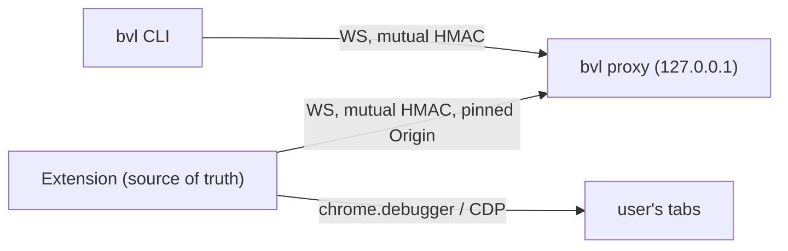

# Architecture

Browser Valet lets coding agents drive the user's **real**, day-to-day Chromium browser (logins,
cookies, open tabs) through `bvl`, instead of a separate test instance. Its commands stay close to
[agent-browser](https://github.com/vercel-labs/agent-browser), which agents already know. It has three parts: a thin Rust CLI, a stateless relay proxy (the same
binary), and an MV3 TypeScript extension that owns all state and logic. It is pre-1.0 (0.x). CI
builds and tests the CLI on Linux, macOS and Windows. The extension has unit tests and a small
Chrome-for-Testing E2E smoke suite on Linux; other browser behaviour is verified by hand. Edge, Brave and other Chromium browsers are
expected to work, but they are not tested.

## Page map

| Page | Read when you are… |
|---|---|
| [glossary.md](glossary.md) | unsure what a term means here (agent tab, shared tab, grant, ref, managed…) |
| [security.md](security.md) | touching pairing, auth, Origin checks, consent, grants, logging, or anything an agent can reach |
| [protocol.md](protocol.md) | changing any message between CLI, proxy and extension (wire contract) |
| [runtime.md](runtime.md) | changing proxy lifecycle, extension state/storage, self-update, persisted files |
| [automation.md](automation.md) | adding/changing commands, CDP usage, input, snapshots/refs, screenshots |
| [ui.md](ui.md) | changing the popup, its theme tokens, or the toolbar badge |
| [development.md](development.md) | building, embedding the extension in the binary, CI, tests, releasing |

## Components

| Component | Owns | Must not contain |
|---|---|---|
| `cli/src/main.rs` (CLI) | argv capture, config file, proxy auto-start, executing `res` (print, write `files`), CLI-local commands | command parsing, help text, formatting, browser state |
| `cli/src/proxy.rs` (proxy) | auth, Origin check, relaying req/event/res/cancel by id, idle exit, triggering managed updates | durable state, knowledge of command semantics |
| `cli/src/embed.rs`, `setup.rs`, `build.rs` | embedded extension + skills, managed folder, `setup`/`skills` | anything the extension must decide at runtime |
| `cli/skills/` | agent guide sources (`bvl skills get`) | version-specific facts not matching the binary |
| `extension/src/background/` | sessions, tabs, grants, refs, parsing, help, output formatting, CDP, consent, activity log | assumptions that the proxy keeps state |
| `extension/src/popup/`, `static/` | consent UI, status, pairing, Nerve theme | logic the worker needs (popup may be closed) |

## Principles

1. **Never act on a tab the user hasn't given.** Agents only control agent tabs and shared tabs. *Why:* this is the user's real profile; consent is the product's core promise.
2. **The pairing secret never crosses the wire, and only the pinned extension origin can be `ext`.** *Why:* any local process or web page can reach `127.0.0.1`.
3. **The extension is the single source of truth; the CLI and proxy stay thin.** *Why:* new commands ship in the extension alone, and proxy or CLI restarts lose nothing.
4. **CLI, proxy, embedded extension and skills are one version.** *Why:* the protocol has no negotiation; a mismatch is handled by restarting or updating, never by compatibility code.
5. **Keep the agent-browser interface** (command names, flags, snapshot and ref format). Deviate only where the real browser requires it (consent, `tab <tN>` approval, no profile-changing commands). *Why:* agents already know agent-browser, so they need no new vocabulary.
6. **Don't modify the user's profile beyond what a command explicitly asks.** *Why:* cookies, storage, device emulation and network interception (not read-only observation) were deliberately left out; viewport and color-scheme emulation exist only on agent tabs (see Settled directions).
7. **Agent tabs stay in the background.** *Why:* the user keeps working while the agent runs; see [automation.md](automation.md) for the cost.

## Change risk

| Area | Risk | Why | Required care |
|---|---|---|---|
| Auth handshake, Origin rule, pinned extension ID / manifest `key` | High | local attackers, web pages; ID change breaks every install | [security.md](security.md) rules; extend `cli/tests/relay.rs`; user sign-off |
| Consent and grants (`tabs.ts`, `Ctx.tab()`) | High | acting on tabs the user didn't share | manual test of approve/deny/revoke/update; user sign-off for any relaxation |
| Persisted files and managed folder path (`config.json`, `pairing.json`, `<data>/extension`) | High | users loaded the folder once by hand; changes strand installs | keep paths and keys; migration if they must change |
| Wire protocol ([protocol.md](protocol.md)) | Medium | all three parts must agree; mitigated by single-version rule | bump all parts together; update protocol.md and relay tests |
| Extension state shape (`chrome.storage.session` `state`, `handoff`) | Medium | handoff from the old version is spread over the new defaults | new fields need defaults; check `restoreHandoff` |
| Command implementations, snapshot format, output text | Low–Medium | agents and skills rely on output shape | update `cli/skills/` in the same change |
| Popup layout and styling | Low | local | normal review; follow [ui.md](ui.md) |

## Decision checklist

- Does it let an agent touch a tab, file or profile data it couldn't before? → security review, user sign-off.
- Does it add state to the CLI or proxy? → move it to the extension.
- Does it change a message, a persisted file, or the managed folder? → update [protocol.md](protocol.md) / [runtime.md](runtime.md); is an old extension or config handled?
- Does it change command behaviour or output? → update `cli/skills/` too.
- Does it work on a hidden (background) tab and on Windows paths?
- Does it log user-typed or page-secret content into the activity log?

## Settled directions

Do not reintroduce these without a proposal ([proposals](../proposals/README.md)):

- Stateful daemon, or argument parsing in the CLI (replaced by the thin CLI and stateless proxy in v0.2).
- `.crx` or self-hosted extension install: Chrome rejects off-store `.crx`. Load unpacked from the managed folder.
- Manual pairing as the default flow: `pairing.json` in the managed folder replaces it. `bvl pair` remains for dev builds.
- Cookies/storage/state commands, network interception (routing, mocking, blocking, header changes), video/trace, and emulation beyond `set viewport` / `set media` on agent tabs (no `set device/geo/offline/headers/credentials`): they would modify the real profile, change what servers see, or aren't needed. `pdf` is allowed (read-only). Read-only network *observation* (`network requests`) is allowed under the redaction rules in [security.md](security.md).
- Firefox support: there is no `chrome.debugger` there.

## Freedom

Anything not stated as **MUST** is open. Defaults may be improved when the reason is recorded in
the PR and the affected page.
