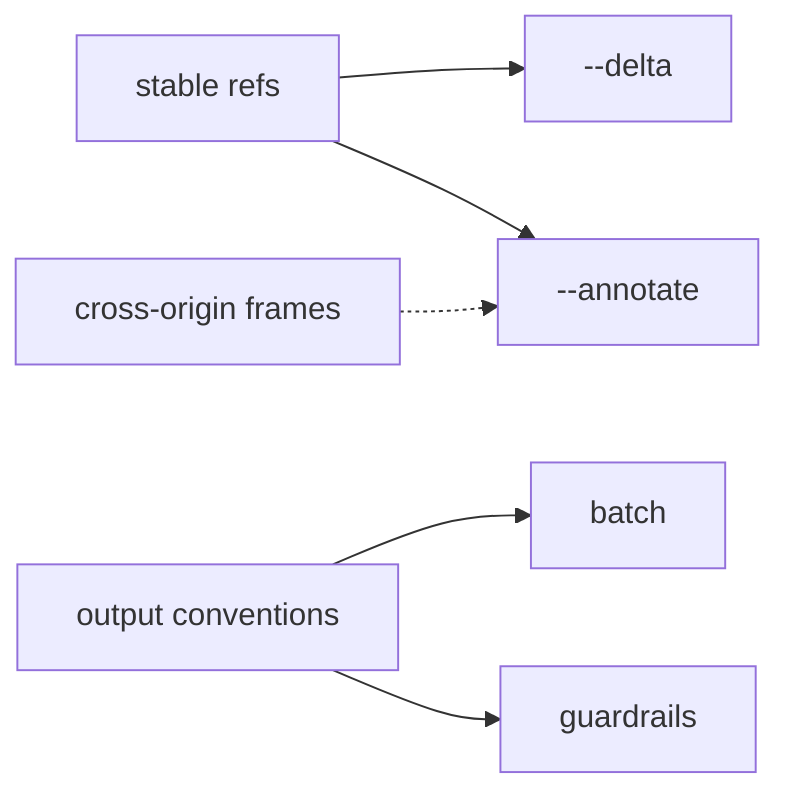

# agent-browser parity: gap analysis

**Status:** Draft · **Area:** automation, security

This is the umbrella record for comparing bctl with agent-browser. It is based on the agent-browser
core skill and on running agent-browser 0.41.2 against local fixtures
([observed-output.md](observed-output.md)). Each gap worth building has its own proposal. This page
lists where each item stands and why.

## Already at parity

open/back/forward/reload/close, `tab` (list/new/label/switch/close), `snapshot -i -c -d -s -u`
(line format identical to the binary), click/dblclick/hover/focus/fill/type/press/keydown/keyup/
keyboard, check/uncheck/select, scroll/scrollintoview, drag, upload, `find` (all locators),
`get text|html|value|attr|title|url|count|box`, `is`, `wait` (target/ms/text/url/load/fn/state),
clickable (`cursor:pointer`/`onclick`) refs and `removedRefs`, `get styles` (curated by default), XPath targets, `mouse`, `highlight`, `pushstate`, `session list/info`,
`screenshot [--full]`, `read` (active tab/URL; no `--raw/--llms/--require-md`), `eval` (inline/-b/--stdin), `dialog`, `console`, `errors`, `--json`,
`--session`, `--timeout`, the `skills` command.

## Proposals

| Proposal | What | Priority |
|---|---|---|
| [snapshot-delta.md](../snapshot-delta.md) | stable, monotonic refs; `snapshot --delta` | **1**: refs pointing to the wrong element is a safety issue in a real browser |
| [cli-output-conventions.md](../cli-output-conventions.md) | wait prints the match, warnings on stderr, JSON error codes, usage on missing args, help examples, JSON field names | 1 |
| [screenshot-improvements.md](../screenshot-improvements.md) | `--annotate`, `--if-changed`, `--threshold` | 2 |
| [cross-origin-frames.md](../cross-origin-frames.md) | inline cross-site iframes; `frame` | 2 |
| [batch.md](../batch.md) | `batch` | 2 |
| [agent-guardrails.md](../agent-guardrails.md) | allowed domains, content boundaries, max output, action confirmation | 3 (security sign-off) |
| [network-observe.md](../network-observe.md) | read-only `network requests` / `request` | 3 (security sign-off) |
| [revisit-pdf-and-viewport.md](../revisit-pdf-and-viewport.md) | `pdf`; `set viewport/media` on agent tabs | 4 (changes a settled direction) |
| [page-audits.md](../page-audits.md) | `a11y`, `vitals` | 4 |

## Out of scope (by principle)

- **They change the user's profile:** `cookies`, `storage`, `state save/load`, `auth` vault,
  `network route`/`unroute`, `har`, `set headers/credentials/offline/geo/device`,
  `addinitscript`/`--init-script`, `clipboard` (system clipboard).
- **Browser launch and hosting, which don't apply to a real browser:** `--cdp`/`connect`,
  `--profile`, `--headed`, `--engine`, `--proxy`, `--executable-path`, `--extension`, `install`,
  `get cdp-url`, `--restore`, `--namespace`.
- **Heavy, and not needed now:** `record`, `trace`, `profiler`, `stream`, `dashboard`, `mcp` server,
  `plugin`, `webmcp` (needs Chrome flags in the user's browser), `react *` (needs a hook installed
  before the page loads).

## Upstream docs vs binary

The upstream skill shows a snapshot format (`Page:`/`URL:` header, `@e1 [tag]` lines) that 0.41.2
does not print. Our skill matches the binary. When upstream changes, re-run the fixture capture
(see the method in [observed-output.md](observed-output.md)) before changing our output.
